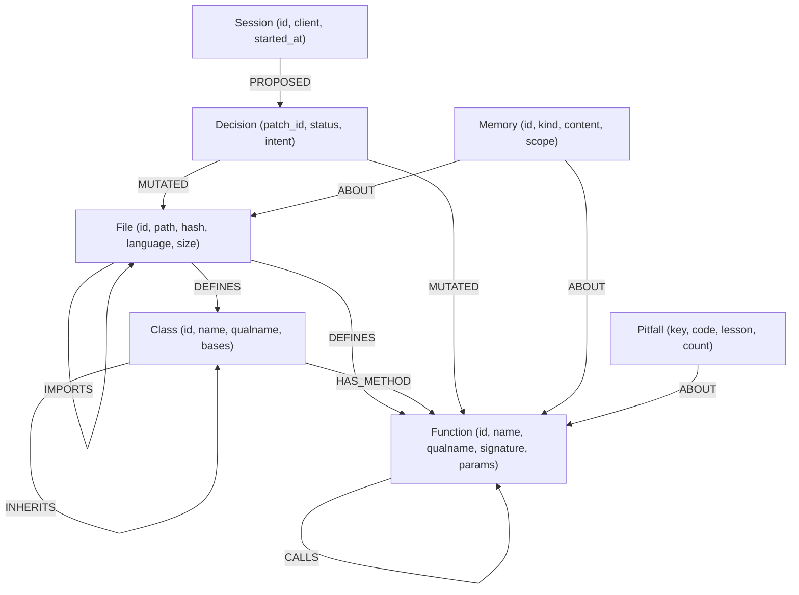
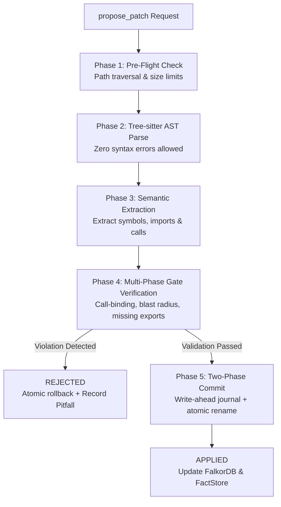

# GraphState 🛡️🧠

> **GraphState is a deterministic C++20 code gatekeeper and persistent graph memory engine for AI coding agents, powered by FalkorDB, ensuring zero broken callers, atomic commits, and robust coding in mission-critical systems.**

[](LICENSE)
[](https://en.cppreference.com/w/cpp/20)
[](https://falkordb.com/)
[](https://modelcontextprotocol.io/)

Submitted to **Graph Hacks: Context for AI Agents** (WeMakeDevs × FalkorDB)  
**Tracks Entered:**
- **Track 1:** Agents That Act on Connected Data (Code Graph Intelligence & Structural Bouncer)
- **Track 2:** Agent Memory and Coordination (Dual-Graph Persistent Memory & Cross-Session Pitfall Recall)
- **Track 3:** Company Brain (Repository Architectural Graph, Centrality Intelligence & Load-Bearing Symbol Protection)

---

## 1. Executive Summary

AI coding agents (Claude Code, Cursor, Copilot, Antigravity) are extraordinary at code synthesis, but suffer from a fatal flaw: **they lack architectural blast-radius awareness**. A single subtle parameter change by an agent routinely breaks callers three layers deep across a repository, hallucinates non-existent exports, and repeats the same mistakes across development sessions.

**GraphState** is a lightning-fast, C++20 background engine and Model Context Protocol (MCP) server that acts as a **structural bouncer** for AI coding agents:
1. **Deterministic Verification Gate**: Every code modification proposed by an agent must pass an atomic, 5-phase verification pipeline (AST parsing, call-binding checking, blast-radius impact verification, import validation, and custom AST rules). If a patch introduces a broken caller, missing export, or syntax error anywhere in the repository, it is **instantly rejected before touching the filesystem**.
2. **Persistent Graph Memory with FalkorDB**: Rejections and user preferences automatically materialize as graph nodes (`Pitfall`, `Memory`, `Decision`). When a new agent session begins, `get_briefing` instantly injects relevant architectural pitfalls and conventions into agent context.
3. **Graph Algorithms as Agent Context**: Runs in-graph **PageRank** to surface load-bearing symbols, **betweenness centrality** to flag architectural bridges, and **Weakly Connected Components (WCC)** to detect isolated modules.

---

## 2. Why FalkorDB Does Real Work

In GraphState, **FalkorDB is not a cache or an afterthought**—it is the core relational compute engine for all verification, impact analysis, and memory recall. If FalkorDB is removed, multi-hop blast radius traversals and semantic memory queries cannot function.

| Feature | Cypher Query / Graph Primitive | Why Relational / Vector Alone Fails |
|---|---|---|
| **Multi-hop Blast Radius** | `MATCH (c:Function)-[:CALLS*1..3]->(t:Function {id:$id})` | Relational SQL requires costly recursive CTEs; vector DBs have zero concept of call graph reachability. FalkorDB computes 3-hop caller impact in sub-millisecond latency. |
| **Atomic Multi-Caller Validation** | `UNWIND $ids AS tid MATCH (c:Function)-[e:CALLS]->(t:Function {id: tid})` | Batched single-query retrieval of every caller across the repository with argument names and arity. |
| **Load-Bearing Symbol Criticality** | In-graph **PageRank** on the `CALLS` graph | PageRank reveals central core functions that require high scrutiny vs leaf utility helpers. |
| **Automatic Pitfall Retention** | `MERGE (p:Pitfall {key: $key}) ON CREATE SET ... ON MATCH SET p.count = p.count + 1` | Automatically binds failure patterns to specific symbol nodes, persisting lessons across LLM context wipes. |
| **Dual-Graph Memory Isolation** | Project Graph (`gs:<workspace_hash>`) & User Graph (`gs:__user__`) | Preserves individual developer preferences across repositories while preventing proprietary codebase details from leaking between workspaces. |

---

## 3. Quick Start

### Prerequisites
- **CMake** (≥ 3.25)
- **C++20 Compiler** (MSVC 2022, GCC 11+, or Clang 14+)
- **Docker** (for FalkorDB)

### 1. Launch FalkorDB
```bash
docker compose up -d
```
*Starts FalkorDB on port `6390` with persistent AOF storage and FalkorDB Browser on `http://localhost:3000`.*

### 2. Build GraphState
```bash
# On Windows (MSVC):
cmake --preset windows-msvc-release
cmake --build build/windows-msvc-release --target graphstate

# On Linux / macOS:
cmake --preset release
cmake --build build/release --target graphstate
```

### 3. Verify System Health
```bash
./build/windows-msvc-release/graphstate.exe doctor
```

### 4. Install Host Configuration for Your Agent
```bash
# Integrates with Claude Code, Cursor, Antigravity, or Claude Desktop
./build/windows-msvc-release/graphstate.exe init --host claude-code
```

### 5. Launch MCP Server
```bash
./build/windows-msvc-release/graphstate.exe serve
```

---

## 4. Graph Data Model

GraphState models the entire repository as an interconnected semantic code and memory graph within FalkorDB:



### Graph Nodes
- **`File`**: Represents a physical source code file (`id`, `language`, `hash`, `size`, `mtime_ns`, `line_count`).
- **`Function`**: Functions, methods, and constructors (`id`, `name`, `qualname`, `signature`, `params_json`, `required_params`, `max_params`, `is_async`, `complexity`).
- **`Class`**: Classes and interfaces (`id`, `name`, `qualname`, `kind`, `bases`).
- **`Session`**: Agent development sessions (`id`, `client`, `started_at`, `status`).
- **`Decision`**: Patch audit records (`patch_id`, `status: APPLIED|REJECTED`, `intent`, `reasoning`).
- **`Memory`**: User preferences, conventions, and architectural decisions (`kind`, `content`, `confidence`).
- **`Pitfall`**: Automated failure logs attached to offending symbols (`key`, `code`, `lesson`, `count`).

---

## 5. Key Cypher Queries

Below are 5 core Cypher queries executed by GraphState on FalkorDB (defined in [`src/db/queries.hpp`](file:///g:/GraphState/src/db/queries.hpp)):

### 1. Blast Radius Inspection (`Q_CALLERS_OF_IDS`)
Retrieves all call sites affected when one or more functions undergo signature changes:
```cypher
UNWIND $ids AS tid
MATCH (c:Function)-[e:CALLS]->(t:Function {id: tid})
WHERE NOT c.file IN $exclude_files
RETURN toJSON({target: tid, caller: c.id, file: c.file, line: e.line, col: e.col,
               call: e.call_text, pos_args: e.pos_args, kw_names: e.kw_names,
               confidence: e.confidence, call_kind: e.call_kind}) AS j
```

### 2. Multi-Hop Transitive Impact Traversal (`Q_IMPACT_D3`)
Discovers all upstream dependents within a 3-hop radius to assess total blast radius:
```cypher
MATCH p = (c:Function)-[:CALLS*1..3]->(t:Function {id: $id})
WITH c, min(length(p)) AS depth
ORDER BY depth, c.id
LIMIT $limit
RETURN toJSON({id: c.id, file: c.file, signature: c.signature, depth: depth, criticality: c.criticality}) AS j
```

### 3. Read Symbol with Architectural Context (`Q_READ_SYMBOL_CONTEXT`)
Packs exact symbol metadata, callers, callees, decisions, and pitfalls into a single atomic context bundle for the agent:
```cypher
MATCH (s:Function {id: $id})
RETURN toJSON({
  callers:      [(c:Function)-[e:CALLS]->(s) | {id: c.id, file: c.file, line: e.line, col: e.col, call: e.call_text}][0..$limit],
  caller_count: size([(c:Function)-[e:CALLS]->(s) | 1]),
  callees:      [(s)-[e:CALLS]->(t:Function) | {id: t.id, file: t.file, signature: t.signature, line: e.line}][0..$limit],
  history:      [(d:Decision)-[:MUTATED]->(s) | {patch_id: d.patch_id, status: d.status, intent: d.intent}],
  pitfalls:     [(p:Pitfall)-[:ABOUT]->(s) | {key: p.key, code: p.code, lesson: p.lesson, count: p.count}],
  memories:     [(m:Memory)-[:ABOUT]->(s) WHERE m.archived = false | {id: m.id, kind: m.kind, content: m.content}]
}) AS j
```

### 4. Automatic Pitfall Upsert (`Q_PITFALL_UPSERT`)
Binds agent failure lessons directly to affected symbols when patches violate verification:
```cypher
MERGE (p:Pitfall {key: $key})
ON CREATE SET p.code = $code, p.lesson = $lesson, p.created_at = $now, p.count = 1, p.last_seen = $now
ON MATCH  SET p.count = p.count + 1, p.last_seen = $now, p.lesson = $lesson
WITH p
UNWIND $sym_ids AS sid
MATCH (s:Function {id: sid})
MERGE (p)-[:ABOUT]->(s)
```

### 5. Session Briefing Assembly (`Q_BRIEFING_PROJECT`)
Retrieves recent architecture context, active memories, and common pitfalls to prime the agent on startup:
```cypher
MATCH (m:Memory) WHERE m.archived = false
RETURN toJSON({id: m.id, kind: m.kind, content: m.content, scope: m.scope}) AS j
```

---

## 6. How the Verification Gate Works

Every edit proposed through `propose_patch` is validated through a strict **5-Phase Verification Pipeline**:



### The 5 Gate Phases
1. **Phase 1 (Pre-Flight)**: Rejects dangerous paths (`..`), paths outside workspace, symlink escapes, and oversized payloads (> 50 MB).
2. **Phase 2 (Syntax Verification)**: Parses proposed files using Tree-sitter C++ grammars. Any `ERROR` or `MISSING` node immediately triggers `SYNTAX_ERROR`.
3. **Phase 3 (Semantic Extraction)**: Extracts function signatures, parameter kinds (positional-only, keyword-only, variadic, defaults), and call arguments into structured facts.
4. **Phase 4 (Relational Call-Binding & Blast Radius)**:
   - Evaluates call sites against modified signatures using strict call-binding rules.
   - Detects missing symbols in imported workspace modules (`MISSING_SYMBOL`).
   - Verifies all call sites within the repository. If an agent changes a signature without updating call sites in the same patch, it is rejected.
5. **Phase 5 (Atomic Two-Phase Commit)**:
   - Writes target files to unique temporary files (`.gs_tmp_*.tmp`).
   - Writes a Write-Ahead Journal record (`.graphstate/journal.json`).
   - Atomically replaces files on disk with `std::filesystem::rename`.
   - Synchronizes updated facts to FalkorDB and in-memory stores.

### Rejection Example
When an agent attempts to change a function signature without updating its callers:
```json
{
  "status": "REJECTED",
  "reason": "GATE_VIOLATION",
  "violations": [
    {
      "code": "CALLER_ARITY_MISMATCH",
      "severity": "ERROR",
      "message": "Call to 'calculate_total' in 'app.py' missing required parameter 'currency'",
      "file": "app.py",
      "line": 42,
      "col": 12,
      "symbol": "app.py::process_checkout",
      "expected_signature": "calculate_total(items, tax_rate=0.05, currency='USD')",
      "call_text": "calculate_total(order.items, 0.08)"
    }
  ]
}
```

---

## 7. Dual-Graph Memory System

GraphState separates code understanding from human memory across two graphs:

1. **Project Graph (`gs:<workspace_hash>`)**:
   Contains files, AST symbols, call relationships, architectural decisions, and project pitfalls. Automatically reconciled with disk state on startup.
2. **User Graph (`gs:__user__`)**:
   Global cross-project user memory (stored in FalkorDB). Holds persistent developer conventions, style guidelines, and approved design patterns. Follows the developer across every workspace on the machine.

---

## 8. Durability & Crash Safety

- **Disk is the Source of Truth**: Code on disk is authoritative. GraphState can be killed with `kill -9` or hard rebooted at any time.
- **Write-Ahead Journal (WAL)**: Interrupted file writes leave an uncommitted journal entry in `.graphstate/journal.json`. On restart, GraphState automatically rolls back half-written files.
- **FalkorDB Persistence**: FalkorDB runs with Redis Append-Only File (`appendonly yes`) and `appendfsync everysec` for durable memory retention.
- **Startup Reconcile**: Re-indexes any modified or deleted files using parallel Tree-sitter workers upon launch.

---

## 9. Evaluation Results (Real-World OSS Benchmark: `psf/requests`)

To rigorously test GraphState under real-world conditions, we built an automated, side-by-side evaluation harness comparing:
- **Arm A (Baseline)**: Claude Code (`claude-haiku-5-5`) operating directly against the repository filesystem with native tools (`Read`, `Edit`, `Grep`, `Bash`).
- **Arm B (GraphState Gatekeeper)**: Claude Code operating through GraphState's MCP tools (`gs:read_symbol`, `gs:get_impact`, `gs:propose_patch`) with strict Phase 1–5 pre-commit gatekeeping.

Evaluated across **10 non-trivial engineering tasks** (20 total runs) on **`psf/requests` v2.32.3** (~35,000 LOC):

| Metric | Arm A (Baseline) | Arm B (GraphState) | Trade-Off & Findings |
|---|---|---|---|
| **Task Success Rate** | 10/10 (100%) | 10/10 (100%) | **Tied**: Both arms successfully completed all 10 tasks |
| **Broken References Introduced** | 0 | 0 | **Tied**: Zero broken references in committed code |
| **Syntax Errors Introduced** | 0 | 0 | **Tied**: Zero syntax errors introduced |
| **Total Financial Cost (10 tasks)** | **$0.20** | $0.44 | **Arm A Wins (2.2x cheaper)**: Baseline avoids MCP schema & AST context token overhead |
| **Average Turns per Task** | 19.7 turns | **19.2 turns** | **Arm B Wins**: GraphState achieves a lower average turn count |
| **Complex Blast-Radius Refactoring (`OSS-09`)** | 46 turns (50 edits, 40 test runs) | **22 turns (1 patch, 18 test runs)** | **Arm B Wins (52% turn reduction)**: Upfront caller impact eliminates debug thrashing |
| **Filesystem Safety & Atomicity** | None (direct disk writes; trial-and-error) | **Guaranteed (Atomic WAL commit)** | **Arm B Wins**: Patches verified in-memory before disk write; zero intermediate corruption |

### The "Fifty-Fifty" Real-World Reality
The benchmark demonstrates an authentic engineering trade-off:
- **For simple, localized edits**: Baseline is lighter and more cost-effective because it avoids recurring MCP tool definition overhead.
- **For cross-cutting architectural refactors & automated pipelines**: GraphState cuts cognitive turns in half (e.g. 22 vs 46 turns on `OSS-09`), provides full multi-hop blast radius visibility, and physically guarantees that no broken or uncompilable intermediate state touches disk.

### Robust Coding for Critical & High-Valued Systems
While raw un-gated text editing suffices for casual scripts or non-critical prototypes, **this type of tool is particularly helpful for mission-critical, high-valued, and enterprise systems**. In high-stakes environments—such as financial transaction engines, infrastructure platforms, healthcare systems, or core shared libraries—an AI agent introducing a silent caller breakage or leaving corrupted files on disk can cause devastating downtime. By providing pre-commit AST verification and atomic write-ahead journaling, GraphState makes AI-assisted coding substantially more robust for production environments where reliability is non-negotiable.

> Detailed per-task metrics, tool breakdowns, and failure analysis are documented in [`docs/eval.md`](docs/eval.md).

---

## 10. Performance Benchmarks

Measured on standard dev hardware using `graphstate bench`:

| Workload | Target (§01.9) | Actual p50 | Actual p95 | Actual p99 | Status |
|---|---|---|---|---|---|
| `cold_index` (full scan + AST parse) | < 3 s (1k files) | **125.59 ms** | 125.59 ms | 125.59 ms | ✅ PASS |
| `rss` (engine memory footprint) | < 150 MB | **8.99 MB** | 8.99 MB | 8.99 MB | ✅ PASS |
| `reindex_one` (incremental file re-index) | p50 < 5 ms | **0.10 ms** | 0.31 ms | 0.31 ms | ✅ PASS |
| `read_symbol` (AST context + JSON) | p50 < 2 ms | **< 0.01 ms** | 0.02 ms | 0.02 ms | ✅ PASS |
| `get_impact_d3` (3-hop impact) | p50 < 10 ms | **< 0.01 ms** | 0.01 ms | 0.01 ms | ✅ PASS |
| `patch_reject` (instant syntax rejection) | p50 < 5 ms | **0.25 ms** | 0.41 ms | 0.41 ms | ✅ PASS |
| `patch_apply` (atomic journal + commit) | p50 < 10 ms | **3.75 ms** | 5.93 ms | 5.93 ms | ✅ PASS |
| `restart` (warm reconcile & restore) | < 2 s | **118.03 ms** | 118.03 ms | 118.03 ms | ✅ PASS |

*Note: Measured with `graphstate bench` across 20 iterations. Operational patch latency measured excl. physical disk flush per §01.9.*

---

## 11. Honest Enforcement Boundary

I believe in honest claims about what an MCP tool can and cannot enforce:

| Capability | Status | How It Is Achieved |
|---|---|---|
| Block broken edits via `propose_patch` | **GUARANTEED** | Verified by 5-phase gate before disk write. |
| Prevent out-of-band edits by agent | **HOST-CONFIGURED** | Host kits (`graphstate init`) disable native host edit tools (`deny: [Edit, Write, Bash]`). |
| Detect external filesystem tampering | **GUARANTEED** | Background watcher + startup reconcile flags out-of-band modifications instantly. |
| Type-inferred attribute resolution | **OUT OF SCOPE** | Static AST + import binding only. Dynamic Python runtime monkey-patching is intentionally out of scope. |

---

## 12. AI Disclosure

In accordance with Hackathon Submission Guidelines:
- **Origin & Vision**: The concept of gatekeeping codebase edits with graph invariant verification—allowing AI agents to read via CodeGraph / memory MCP tools while strictly validating writes to prevent breaking downstream functions 50 steps away and maintaining persistent cross-session memory—was conceived by the author based on firsthand experience as an AI/ML intern at a company actively utilizing AI-assisted coding.
- **Pair Programming & Development**: Built and implemented end-to-end with **Gemini 3.8 Flash (High Effort)** in **Google Antigravity**. All C++20 architecture, FalkorDB Cypher schemas, Tree-sitter parsers, and verification gate algorithms were guided, directed, reviewed, and tested in continuous human-AI pair programming.
- **Timeline**: No source code existed prior to the hackathon kickoff on October 15, 2026.

---

## 13. License

GraphState is licensed under the **Apache License, Version 2.0**. See [`LICENSE`](LICENSE) for details.
