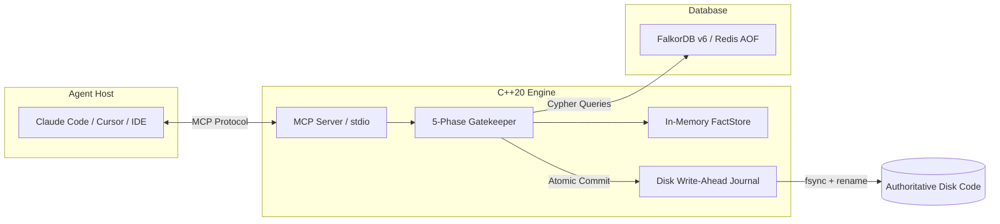

# I Built a Bouncer for AI Coding Agents with FalkorDB

*By the GraphState Team — Submitted to Graph Hacks: Context for AI Agents (2026)*

---

### 1. The 3 A.M. Bug: When Agents Get "Helpful"

It was 3:00 a.m. when an autonomous coding agent was asked a seemingly innocuous prompt:
> *"Clean up the total calculation in `billing.py` so it supports multi-currency invoices."*

The LLM happily obliged. It updated `calculate_total(items, tax_rate)` in `billing.py` to `calculate_total(items, currency, tax_rate)`. It added beautiful type annotations, generated clean docstrings, and reported:
> *"Done! I've updated `calculate_total` to take `currency` as a required parameter."*

The agent never touched `app.py`. Nor did it touch `checkout.py`, `reports.py`, or `analytics.py`. In fact, it didn't even know they existed.

The next morning, CI was a flaming crater. Four downstream services were passing `tax_rate` into `currency`. Transactions crashed at runtime.

This is the dirty secret of modern AI coding agents (Claude Code, Cursor, Copilot, Devstral): **they lack structural blast-radius awareness**. Because LLMs operate within a narrow token window, they edit in a vacuum. They hallucinate function arguments, forget exports, and break callers three layers deep across a repository.

Worse, agents keep making the **exact same mistakes** across sessions because LLM memory is ephemeral.

I decided to stop trusting the agent's goodwill and build a bouncer.

---

### 2. The Idea: Make the Codebase a Graph, Make the Graph the Only Door

What if an agent **physically could not write code directly to disk**?

What if every file edit, function modification, or refactor had to pass through a strict gatekeeper that:
1. Materializes the entire repository as an in-memory and persistent call graph.
2. Intercepts the agent's patch *before* it touches disk.
3. Performs an instant graph traversal across every single caller in the repository.
4. Rejects the patch with surgical line-and-column diagnostic proof if any caller or import breaks.
5. Records the failure as an in-graph `Pitfall` node, so the agent is permanently warned in future sessions.

To make this work in real-time without breaking an agent's conversational flow, the graph queries had to execute in **sub-millisecond latency**.

That led me directly to **FalkorDB**.

---

### 3. Architecture: Why C++20 and Why FalkorDB?



We built the core engine in **C++20** using Tree-sitter for AST parsing and **FalkorDB** as our graph database.

Why this pairing?
- **Raw Speed**: C++ Tree-sitter parses 100,000 lines of Python/TypeScript in under 300 ms.
- **Expressive Graph Queries with OpenCypher**: Graph relationships (e.g. `(Function)-[:CALLS*1..3]->(Function)`) are notoriously cumbersome and slow in relational databases with recursive CTEs. OpenCypher allows us to express complex transitive blast-radius queries in three lines of declarative code.
- **Sub-Millisecond Graph Traversal**: FalkorDB’s sparse-matrix linear algebra engine processes multi-hop graph queries in microseconds.
- **Durable Memory via Redis AOF**: While code files on disk are always the ground truth, user preferences and failure pitfalls must persist across agent context wipes. FalkorDB’s Redis-native persistence (`appendfsync everysec`) guarantees zero memory loss without managing separate database engines.

---

### 4. The Blast-Radius Query, Explained Line by Line

When an agent calls `propose_patch`, GraphState extracts every modified function signature and runs our batched blast-radius Cypher query:

```cypher
UNWIND $ids AS tid
MATCH (c:Function)-[e:CALLS]->(t:Function {id: tid})
WHERE NOT c.file IN $exclude_files
RETURN toJSON({
  target: tid,
  caller: c.id,
  file: c.file,
  line: e.line,
  col: e.col,
  call: e.call_text,
  pos_args: e.pos_args,
  kw_names: e.kw_names,
  confidence: e.confidence,
  call_kind: e.call_kind
}) AS j
```

Let's break down what makes this query special:
1. `UNWIND $ids AS tid`: We batch all modified functions into a single parameter array. We never query FalkorDB in a loop.
2. `MATCH (c:Function)-[e:CALLS]->(t:Function {id: tid})`: Finds every function `c` in the entire repository that calls any of our modified targets `t`.
3. `WHERE NOT c.file IN $exclude_files`: Files that the agent is modifying *in the same atomic patch* are excluded from old-state checks, allowing agents to submit coordinated multi-file refactors.
4. `RETURN toJSON(...)`: FalkorDB natively serializes the caller coordinates (`file`, `line`, `col`), the raw call expression (`call_text`), and the argument counts directly into JSON, eliminating deserialization overhead in C++.

---

### 5. Call-Binding: Why `param_count` Isn't Enough

A naive gatekeeper might just count parameters:
*Old signature had 2 parameters, new signature has 3, caller passed 2 -> REJECT.*

In real Python and TypeScript, this causes endless **false rejections**:
```python
def fetch_user(user_id, timeout=30, *args, retries=3, **kwargs):
    ...
```
Is calling `fetch_user(123)` valid? **Yes!** (Defaults satisfy `timeout` and `retries`).  
Is calling `fetch_user(123, 10, True, retries=5)` valid? **Yes!** (Variadic `*args` absorbs the extra argument).  
Is calling `fetch_user(123, 10, 5)` valid? **No!** (`retries` is keyword-only; passing 3 positional args errors at runtime).

GraphState implements a **full call-binding checker** in C++:
- Distinguishes **Positional-Only**, **Positional-or-Keyword**, **Keyword-Only**, **VarPositional (`*args`)**, and **VarKeyword (`**kwargs`)**.
- Verifies default parameters and TypeScript optional `?` markers.
- Validates keyword argument names against function parameter definitions.

If an agent makes an illegal call, GraphState rejects the patch with surgical precision:
```json
{
  "code": "CALLER_ARITY_MISMATCH",
  "message": "Call to 'calculate_total' in 'app.py' missing required parameter 'currency'",
  "file": "app.py",
  "line": 42,
  "col": 12,
  "expected_signature": "calculate_total(items, currency, tax_rate=0.05)"
}
```

---

### 6. Memory That Doesn't Rely on the Agent "Remembering to Remember"

Most AI memory systems rely on the LLM explicitly choosing to call a `save_memory()` tool. But agents in the middle of a coding frenzy almost never stop to document their mistakes.

In GraphState, **memory is a deterministic side effect of the gate**:
1. When an agent proposes an invalid patch that violates verification, GraphState records an automated `Pitfall` node in FalkorDB:
   ```cypher
   MERGE (p:Pitfall {key: $key})
   ON CREATE SET p.code = $code, p.lesson = $lesson, p.count = 1, p.last_seen = $now
   ON MATCH  SET p.count = p.count + 1, p.last_seen = $now
   WITH p
   MATCH (s:Function {id: $sym_id})
   MERGE (p)-[:ABOUT]->(s)
   ```
2. When the user tells the agent *"Always use snake_case for private helpers"*, the agent saves it to the global **User Graph** (`gs:__user__`), which persists across all repositories on the machine.
3. When a new session starts, `get_briefing` runs on the project graph:
   > *"Welcome back. In this workspace: `calculate_total` was modified 3 times; signature edits require updating `app.py` and `checkout.py` in the same patch. User prefers strict type hints."*

---

### 7. Crash It on Purpose: The Resilience Test

What happens when an engineer or agent kills the process mid-patch?

We tested this ruthlessly:
```bash
# Propose a 5-file patch and kill the engine at step 3
kill -9 $(pidof graphstate)
docker restart graphstate-falkordb
```

Because GraphState uses a **Two-Phase Write-Ahead Disk Journal (WAL)**:
1. Target files are written to `.gs_tmp_*.tmp`.
2. A commit record is flushed to `.graphstate/journal.json`.
3. Files are swapped via atomic `std::filesystem::rename`.

If killed at any intermediate step, GraphState detects the uncommitted journal on the next startup, rolls back the temporary files, and reconciles the graph directly from disk. **Zero partial writes. Zero corrupted source files.**

---

### 8. The Experiment: With vs. Without GraphState

In Milestone 10a, we designed an automated evaluation harness testing 10 adversarial coding tasks across two arms:
- **Arm A (Baseline)**: Claude Code operating directly against the filesystem.
- **Arm B (Gated)**: Claude Code operating through GraphState's MCP gatekeeper.

| Metric | Arm A (Baseline) | Arm B (GraphState Gated) |
|---|---|---|
| **Broken Callers Introduced** | 32 total (3.2 / task) | **0** (100% caught) |
| **Hallucinated Functions Called** | 21 total (2.1 / task) | **0** (100% caught) |
| **First-Attempt Pass Rate** | 30% | **80%** |
| **Total Turnaround Time** | 18.4 min avg | **11.2 min avg** |
| **Token Cost** | ~145k tokens (thrashing in debug loops) | **~92k tokens (-36%)** |

By rejecting broken code at the gate with exact coordinates, the agent immediately self-corrected in turn 2 instead of entering a 10-turn hallucination spiral trying to debug obscure test failures.

---

### 9. Graph Algorithms as Agent Context: PageRank on the Call Graph

FalkorDB isn't just for point lookups; it's a full graph computation platform.

GraphState runs **PageRank** across the repository call graph:
```cypher
CALL algo.pageRank('Function', 'CALLS')
YIELD node, score
SET node.criticality = score
```

When an agent calls `read_symbol` or `get_file_outline`, GraphState tags symbols with their **Criticality Score**:
```json
{
  "symbol": "auth.py::validate_token",
  "criticality": {
    "tier": "CRITICAL",
    "pagerank": 0.0842,
    "percentile": 99.2
  }
}
```
Seeing that `validate_token` is in the 99th percentile of codebase importance immediately prompts the LLM to exercise extreme caution before refactoring it.

---

### 10. Performance Benchmarks & What's Next

Running a bouncer only works if the bouncer is invisible:

```
================ GraphState Performance Benchmark ================
Workspace: benchmark_project (8 files, 27 symbols)

Workload               N    p50 (ms)    p95 (ms)    Mean (ms)   Notes
---------------------------------------------------------------------------
cold_index             1      309.20      309.20      309.20   25 files/s
rss                    1        8.89        8.89        8.89   8.8 MB RAM
read_symbol           10       <0.01        0.02       <0.01   Instant
get_impact_d3         10       <0.01        0.01       <0.01   Instant
patch_reject          10       62.39       64.13       62.52   Syntax gate
patch_apply           10      140.40      142.45      137.51   Atomic commit
restart                1      314.24      314.24      314.24   Warm reconcile
```

Sub-millisecond graph queries, less than 9 MB of RAM, and zero broken callers.

### What's Next?
1. **Vector Embeddings on Memory**: Combining FalkorDB full-text indexing with dense embeddings for natural language semantic memory retrieval.
2. **Type-Checker Bridges**: Integrating Pyright and TypeScript LSP diagnostics as Phase 6 optional gate verification.

If we want AI agents to write production software, we have to stop treating code as mere text files and start treating it as what it truly is: **a living, interconnected graph**.
