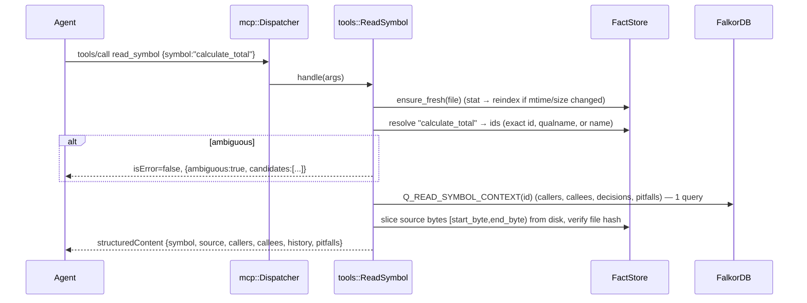

# 02 — Architecture

> Index: [README.md](README.md). Previous: [01-product-and-scope.md](01-product-and-scope.md).

## 2.1 System topology

```
┌──────────────────────────────────────────────────────────────────────────┐
│  Agent host: Claude Code / Google Antigravity / Cursor / Claude Desktop  │
│  - native Edit/Write tools DENIED by host config (see 09)                │
│  - spawns `graphstate serve --root <repo>` as an MCP stdio subprocess    │
└───────────────┬──────────────────────────────────────────────────────────┘
                │ JSON-RPC 2.0, newline-delimited, over stdin/stdout
                │ (logs → stderr + .graphstate/logs/engine.log)
                ▼
┌──────────────────────────────────────────────────────────────────────────┐
│                     graphstate  (C++20, single process)                  │
│                                                                          │
│  mcp/        StdioTransport → Dispatcher → ToolRegistry → handlers       │
│                                   │                                      │
│  ┌────────────────┬───────────────┼──────────────┬────────────────────┐  │
│  │ index/         │ gate/         │ memory/      │ lang/              │  │
│  │ Scanner        │ Gate          │ Sessions     │ LanguageRegistry   │  │
│  │ Indexer        │ OpsApplier    │ MemoryStore  │ Parser (RAII)      │  │
│  │ Resolver       │ SyntaxCheck   │ Briefing     │ PythonExtractor    │  │
│  │ FactStore (RAM)│ SymbolDiff    │ Pitfalls     │ TsExtractor        │  │
│  │ GraphWriter    │ BlastRadius   │              │ BindingChecker     │  │
│  │ Watcher(thread)│ RefCheck      │              │ Metrics            │  │
│  │                │ RulesEngine   │              │                    │  │
│  │                │ DiskTxn+WAL │              │                    │  │
│  └───────┬────────┴───────┬───────┴──────┬───────┴────────────────────┘  │
│          │                │              │                               │
│  db/     GraphClient (hiredis, 1 connection per thread) + Cypher params  │
│  core/   Config · Logger · Result<T> · Hash · Paths · Clock · Ids        │
│  platform/  files · processes · stdio · signals (POSIX | Win32, §12)     │
└──────────┬─────────────────────────────────────────┬─────────────────────┘
           │ std::filesystem / POSIX                  │ TCP 127.0.0.1:6379 (RESP)
           ▼                                          ▼
┌──────────────────────────────┐        ┌─────────────────────────────────────┐
│ Workspace (source of truth   │        │ FalkorDB (Docker, named volume)     │
│ for code)                    │        │  graph gs:<workspace_key>           │
│  src/…                       │        │   ├─ code subgraph (derived)        │
│  .graphstate/                │        │   └─ project memory (authoritative) │
│    config.json  rules.json   │        │  graph gs:__user__                  │
│    wal/  logs/               │        │   └─ user memory (authoritative)    │
└──────────────────────────────┘        │  AOF everysec + RDB snapshots       │
                                        │  Browser UI :3000 (demo)            │
                                        └─────────────────────────────────────┘
```

### Source-of-truth rules (MUST)

1. **Disk is the source of truth for code.** The code subgraph is a materialized index and can always be rebuilt from disk (`graphstate index --full`).
2. **FalkorDB is the source of truth for memory** (sessions, intents, decisions, pitfalls, memories). Never derivable — never deleted by re-indexing.
3. **FactStore (RAM) is a cache** of per-file parse results, rebuilt at startup by parsing the workspace. It exists so call resolution and gate checks never wait on the network.
4. Code-subgraph writes are **idempotent upserts keyed by stable ids**, so replaying any write is safe.

## 2.2 Process & threading model

| Thread | Owns | Does |
|---|---|---|
| **main** | `GraphClient conn_main`, stdin, stdout writer | Reads one JSON-RPC line, dispatches **synchronously**, writes the response. Requests are processed strictly in arrival order. |
| **watcher** | `GraphClient conn_watch` | Every `watch.interval_ms` (default 500) checks mtimes/sizes of indexed files and the directory listing; for changed files acquires `Engine::state_mu`, re-indexes, flags ungated writes. |
| **index pool** (transient) | none | `std::thread`s (N = `hardware_concurrency()`, max 8) used only during full index to parse files in parallel. Joined before graph writes. |

- `Engine::state_mu` (`std::mutex`) protects FactStore, Resolver tables, and all graph **writes**. Every tool handler that reads FactStore or writes the graph takes it for its whole duration. Read-only graph queries from main also take it (simplest correct; tools are ms-scale).
  `// ponytail: one global state lock; per-file locks if watcher contention ever shows in bench.`
- hiredis contexts are **not thread-safe** → one `GraphClient` per thread, never shared.
- stdout is written only through `StdioTransport::send()` guarded by `out_mu` (watcher may emit `notifications/message`).
- No async runtime, no coroutines.

## 2.3 Startup sequence (`graphstate serve`)

```
1  Parse CLI args + env → Config (core/config). Resolve workspace root (realpath).
2  Logger: stderr (level from config) + rotating file .graphstate/logs/engine.log.
3  WAL recovery: if .graphstate/wal/*.json exists → roll back each pending txn (§06.9). Log result.
4  Connect GraphClient(main) with retry: 10 attempts, 200 ms backoff. On failure → still start MCP,
   but every tool returns isError with code DB_UNAVAILABLE and the `docker compose up -d` hint.
5  Schema: ensure graphs gs:<key> and gs:__user__ exist with indexes (idempotent, §04.6).
   Check (:Meta).schema_version; migrate if lower; refuse if higher (newer engine wrote it).
6  Scan workspace → file list (§05.3).
7  Parse all files in parallel → FactStore. (Unchanged files are still parsed; ~1 ms/file.)
8  Reconcile with graph: fetch (path, hash) for all :File nodes; for each file
      new → upsert; hash differs → upsert; missing on disk → delete subgraph.
   Resolve calls for all files whose facts or whose imported files changed; write CALLS edges.
9  Sessions: mark every Session with status "ACTIVE" and no heartbeat in the last
   `memory.session_timeout_s` (default 120) as "INTERRUPTED"; their open Intents remain "OPEN".
10 Start watcher thread.
11 Enter MCP loop. Session node is created on the first MCP request: legacy `initialize` or the first modern request carrying `_meta` (§07.2, §08.2).
Ready-time target: < 2 s for 100 k LOC unchanged.
```

## 2.4 Shutdown

- On stdin EOF or a shutdown request (`platform::on_shutdown_request`: SIGTERM/SIGINT on POSIX, console control events on Windows): stop watcher (atomic flag + join), mark current Session `ENDED` (if `end_session` was not called, `summary` = auto-summary §07.5), flush logs, exit 0.
- On SIGKILL / crash: nothing runs. Recovery is entirely in startup steps 3, 8, 9. **Never rely on shutdown code for correctness.**

## 2.5 Core data flows

### 2.5.1 Read: `read_symbol`



### 2.5.2 Write: `propose_patch`

```mermaid
sequenceDiagram
  participant A as Agent
  participant Gt as gate::Gate
  participant F as FactStore
  participant G as FalkorDB
  participant D as Disk
  A->>Gt: propose_patch {intent, reasoning, edits:[...]}
  Gt->>F: P0 preflight (paths, protected, freshness, base_hash)
  Gt->>Gt: P1 edit: build post-state in memory → post-state buffers
  Gt->>Gt: P2 syntax (tree-sitter) on post-state
  Gt->>F: P3 extract post-state facts, diff vs pre-state facts
  Gt->>G: P4 blast radius: callers of changed/removed symbols (Q_CALLERS_OF_IDS)
  Gt->>F: P4 outgoing-ref check for new/changed code
  Gt->>Gt: P5 quality rules on added/changed symbols
  alt any error violation
    Gt->>G: record Decision(REJECTED) + Pitfalls (+ link Intent/Session)
    Gt-->>A: {status:"REJECTED", phase, violations, lessons}
  else ok
    Gt->>D: P6 WAL begin → tmp+fsync → rename → WAL end
    Gt->>F: replace facts for edited files; re-resolve dependents
    Gt->>G: upsert file subgraphs + CALLS edges + Decision(APPLIED)-[:MUTATED]->symbols
    Gt-->>A: {status:"APPLIED", files, symbols_changed, warnings, timings}
  end
```

### 2.5.3 Out-of-band edit (watcher)

```
watcher tick → stat all indexed files (+ list dirs for new files)
  changed(file) and no WAL txn in flight for it:
    lock state_mu
    pre = FactStore[file]; post = parse(disk)
    run Gate phases P2–P4 in "audit" mode (pre→post) → audit findings
    if config.gate.mode == "enforce" and source is not a known human editor*:
        record (:Decision {actor:"external", status:"UNGATED"}) with findings
    FactStore[file] = post; re-resolve dependents; upsert graph
    push findings into NoticeQueue → attached as `notices` to the NEXT tool result
  unlock
```
\* The engine cannot tell who edited a file. It records every out-of-band change as `actor:"external"`; if findings contain errors (e.g. broken callers), they are surfaced to the agent in the next tool result so the agent fixes them. This is the honest version of "agents cannot bypass the gate".

### 2.5.4 Crash recovery

```
kill -9 while WAL state = PREPARED/RENAMING (some files renamed) → startup step 3 restores backups → disk = pre-patch. Decision recorded as REJECTED/WRITE_FAILED from WAL payload.
kill -9 after WAL state = RENAMED (all files on disk)            → startup step 3 rolls FORWARD: keeps disk, writes the Decision from the WAL payload; step 8 re-indexes by hash.
kill -9 after graph upsert + Decision, before WAL delete         → roll-forward is idempotent (Decision MERGEd by patch_id) → no duplicate.
docker restart falkordb                                         → AOF replay; GraphClient auto-reconnects on next command.
```

## 2.6 Latency budget (`propose_patch`, single file, ~300-line Python file, 1 symbol replaced)

| Step | Budget |
|---|---|
| JSON parse + dispatch | 0.05 ms |
| P0 preflight (stat, hash 10 KB) | 0.05 ms |
| P1 apply | 0.02 ms |
| P2 parse (tree-sitter, full reparse of one file) | 0.3 ms |
| P3 extract + diff | 0.2 ms |
| P4 blast radius (1 FalkorDB round trip) | 0.5 ms |
| P5 rules (query cursors on changed nodes) | 0.3 ms |
| P6 WAL + write + fsync + rename | 1–5 ms (disk-bound, macOS fsync is slow; `F_FULLFSYNC` NOT used) |
| Graph upsert (1 pipelined multi-query round trip) | 1.0 ms |
| Decision/memory record (pipelined with above) | 0 ms extra |
| Response serialize | 0.05 ms |
| **Total** | **≈ 3–8 ms** |

Rules to hit the budget (MUST):
- Never call FalkorDB inside a per-symbol loop. Batch with `UNWIND $rows` and pipeline commands (`redisAppendCommand` × N then `redisGetReply` × N).
- Tree-sitter `TSQuery` objects compiled **once** per language at startup, cached in `LanguageRegistry`.
- One `TSParser` per thread (thread_local), reused.
- No regexes on hot paths (use `std::string_view` ops).

## 2.7 Failure modes & behavior

| Failure | Behavior |
|---|---|
| FalkorDB down at startup | MCP still serves; tools return `isError:true`, `error.code="DB_UNAVAILABLE"`, hint. `status` tool works. |
| FalkorDB dies mid-session | Next command fails → one reconnect attempt → if still down, `DB_UNAVAILABLE`. `propose_patch` refuses to write if DB is down (cannot record memory / run blast radius). Config `gate.allow_write_without_db=false`. |
| File unreadable / binary / > `index.max_file_bytes` (1 MiB) | Skipped from index, `File.skipped_reason` set. |
| Parse produces ERROR nodes in an existing file (pre-existing) | Indexed best-effort (tree-sitter is error-tolerant); `File.parse_ok=false`. Gate only blocks errors **introduced** by a patch (§06.4). |
| Malformed JSON-RPC line | JSON-RPC error −32700, continue loop. |
| Unknown tool | Protocol error −32602 (`Unknown tool`). |
| Tool handler throws | Caught at dispatcher; result `isError:true`, `error.code="INTERNAL"`, message; full stack-less context logged. Engine never exits on a handler exception. |
| Disk full during P6 | Rename never happens; WAL rollback; `REJECTED` with `WRITE_FAILED` (not recorded as Pitfall — not the agent's fault). |
| Windows: target file locked by another process (editor, antivirus, indexer) | `platform::replace_file` retries 20 × 25 ms; then `WRITE_FAILED` (evidence: path, Win32 error) + WAL rollback. |
| Bulk external change (git checkout/pull) | One `SYNCED` Decision + one notice; no per-file UNGATED spam (§06.15). |
