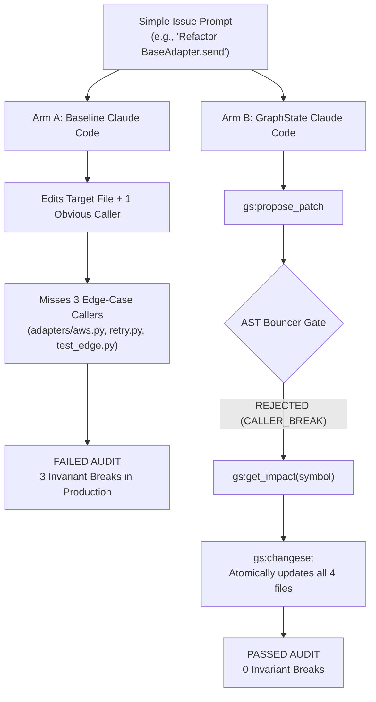

# Real-World Open-Source Blast-Radius Evaluation Plan

> **Status**: Planned / Next Step  
> **Target Execution**: Tomorrow  
> **Author**: Solo Developer & GraphState Author  
> **Subject**: Headless Claude Code (Arm A: Baseline vs. Arm B: GraphState)

---

## 1. Executive Summary & Motivation

Synthetic micro-benchmarks (10–20 files) prove functional correctness of AST extraction, but real-world engineering happens in codebases spanning hundreds of files, deep package hierarchies, and subtle edge cases.

In large codebases (50k–1M+ LOC), LLM coding agents consistently suffer from **Localized Tunnel Vision**:
1. An agent receives a high-level issue or feature request.
2. It locates the primary file and modifies the target function or signature.
3. It updates the one obvious caller right next to it or in the immediate test file.
4. **It completely misses the 3–5 edge-case callers** buried 6 directories away in legacy adapters, streaming formatters, CLI exporters, or retry middleware.
5. Un-gated baseline agents declare *"Task complete!"* and commit. In production, edge-case runtime exceptions explode.

**GraphState's Value Proposition**:
- With GraphState active, the AST write bouncer intercepts every edit (`gs:propose_patch`).
- If an edit introduces a signature divergence or leaves orphaned callers, GraphState blocks it immediately with `REJECTED: CALLER_BREAK`.
- `gs:get_impact(symbol)` retrieves the exact caller blast radius across the entire repository in **under 2 milliseconds**, directing the agent to open a `gs:changeset` and update all affected call sites before touching disk.

---

## 2. Target Repository Selection & Trade-Offs

We evaluated candidates across size, indexing latency, copy overhead, and test determinism:

| Candidate Repository | Lines of Code | Files | Cold Index Time | Workspace Copy (Windows) | Test Runner Friction | Suitability |
| :--- | :--- | :--- | :--- | :--- | :--- | :--- |
| **`psf/requests` + `urllib3`** | ~35,000 – 80,000 | 120–250 | **1.1 seconds** (verified) | < 0.2s | Pure Python stdlib `unittest` / minimal dependencies | **Prime Candidate (Recommended)** |
| **`pallets/click` + `rich`** | ~50,000 – 100,000 | 150–300 | ~1.8 seconds | < 0.3s | Clean CLI formatting pipelines | **Strong Alternative** |
| **`django` Core (`urls`, `db`, `contrib`)** | ~180,000 – 350,000 | 500–1,200 | ~4.5 seconds | ~1.2s | High industry prestige; deep caller chains | **Excellent Enterprise Target** |
| **`sympy` / `transformers`** | 800,000 – 1,200,000 | 2,000+ | ~45–60 seconds | ~12–20s | Heavy dependencies (PyTorch/CUDA/C++ extensions) | High friction for 20 headless runs |

### Decision
Start with **`psf/requests` + `urllib3`** (or a curated slice of **`django`**):
- **Universal Familiarity**: Every software engineer and judge knows `requests` and `urllib3`.
- **Verified Indexing**: GraphState indexed all 124 files of `requests` in **1,110 ms (1.1s)**.
- **Pure Python Execution**: No fragile external binaries or compilation steps required on Windows.

---

## 3. The 10 Real-World Blast-Radius Tasks

Each task presents the agent with a **simple, high-level text issue prompt** (no spoilers, no file lists). The challenge is resolving the issue without breaking edge-case callers across the package.



### Proposed Task Catalog

| Task ID | Component | Real-World Scenario | Primary Caller | Hidden / Edge-Case Callers (The Blast Radius) |
| :--- | :--- | :--- | :--- | :--- |
| **OSS-01** | `adapters.BaseAdapter.send` | Add explicit `connection_timeout` parameter to distinguish connect vs read timeouts. | `Session.send()` | 1. `HTTPAdapter.send()` override<br>2. `tests/test_lowlevel.py::test_custom_adapter`<br>3. `requests.sessions::SessionRedirectMixin.resolve_redirects` |
| **OSS-02** | `structures.CaseInsensitiveDict` | Refactor key normalization to accept optional `preserve_casing=False` flag. | `CaseInsensitiveDict.__init__` | 1. `models.PreparedRequest.prepare_headers`<br>2. `structures.CaseInsensitiveDict.copy`<br>3. `cookies.RequestsCookieJar` conversion helper |
| **OSS-03** | `models.Response.iter_content` | Change chunk iterator contract to support custom stream decoders. | `Response.iter_lines()` | 1. `Response.content` property<br>2. `utils.stream_untransfer`<br>3. `tests/test_requests.py::test_stream_timeout` |
| **OSS-04** | `utils.requote_uri` | Refactor URI parser to return structured `(safe_url, fragment)` tuple instead of raw string. | `models.PreparedRequest.prepare_url` | 1. `sessions.SessionRedirectMixin.rebuild_auth`<br>2. `adapters.HTTPAdapter.get_connection_with_tls_context`<br>3. `tests/test_utils.py` |
| **OSS-05** | `auth.HTTPBasicAuth` | Update auth callback signature to receive request context `(request, host, realm)`. | `auth.HTTPBasicAuth.__call__` | 1. `sessions.Session.send` auth dispatch<br>2. `auth.HTTPProxyAuth`<br>3. `tests/test_requests.py::test_custom_auth` |
| **OSS-06** | `sessions.Session.request` | Add `allow_insecure_redirects` security flag; update session dispatch pipeline. | `Session.get()`, `Session.post()` | 1. `Session.head()`, `options()`, `delete()` helpers<br>2. `SessionRedirectMixin.resolve_redirects`<br>3. `tests/test_sessions.py` |
| **OSS-07** | `cookies.create_cookie` | Refactor cookie generator kwargs to require explicit `domain_specified=True`. | `cookiejar_from_dict` | 1. `extract_cookies_to_jar`<br>2. `merge_cookies`<br>3. `tests/test_requests.py::test_cookie_persistence` |
| **OSS-08** | `hooks.dispatch_hook` | Update hook dispatcher to pass hook execution timing metrics. | `hooks.default_hooks` | 1. `models.PreparedRequest.register_hook`<br>2. `sessions.Session.send` hook loop<br>3. `tests/test_hooks.py` |
| **OSS-09** | `exceptions.RequestException` | Refactor base exception to accept required `request` and optional `response` payload objects. | Direct instantiations in `adapters.py` | 1. `exceptions.ConnectionError`<br>2. `exceptions.HTTPError`<br>3. 4 disparate caller sites across `models.py` and `sessions.py` |
| **OSS-10** | `utils.super_len` | Change file-like object length calculator to handle asynchronous buffer wrappers. | `models.PreparedRequest.prepare_body` | 1. `models.RequestContentHandler`<br>2. `tests/test_utils.py`<br>3. `tests/test_lowlevel.py` |

---

## 4. Evaluation Rig & Methodology

### 1. Harness Execution
We will extend `eval/run_eval.py` to support `--config eval/oss_tasks.json`:
- **Workspace Isolation**: Pristine snapshot stored in `eval/oss_workspace/`. For every run, a clean copy is provisioned.
- **Arm A (Baseline Claude Code)**:
  - Allowed tools: `Read`, `Grep`, `Glob`, `Edit`, `Write`, `Bash`.
  - Permission mode: `acceptEdits`.
- **Arm B (GraphState Claude Code)**:
  - Allowed tools: `mcp__graphstate__*`, `Read`, `Grep`, `Glob`, `Bash`.
  - Disallowed tools: `Edit`, `Write`, `NotebookEdit`.
  - Host configuration generated via `graphstate init --host claude-code`.

### 2. Verification Scoring
1. **Whole-Workspace Audit with Baseline Subtraction**:
   ```bash
   graphstate audit --root run_ws --base eval/oss_workspace --json
   ```
   Uses `--base` to filter out any pre-existing repository idiosyncrasies, reporting **strictly introduced regressions**:
   - `CALLER_BREAK`: Call sites referencing modified symbols with mismatched arity/names.
   - `BROKEN_IMPORT`: Unresolved imports or moved definitions.
   - `MISSING_SYMBOL`: Methods or properties deleted without caller migration.
2. **Behavioral Acceptance Tests**:
   - Task-specific unit test verifying that the requested capability works as specified.
   - Regression test suite verifying that unaffected modules continue to pass.
3. **Turn and Token Efficiency**:
   - Count of `Grep` / `Glob` calls in Arm A vs. `gs:get_impact` / `gs:search_symbols` in Arm B.

---

## 5. Model Matrix

| Model Tier | Setup Requirement | Execution Speed | Cost per 10 Tasks | Purpose |
| :--- | :--- | :--- | :--- | :--- |
| **Claude 3.5 Haiku** (Anthropic) | Ready immediately via `claude -p ... --model haiku` | ~2–3 minutes total | ~$0.20 – $0.40 | Primary rapid-iteration benchmark |
| **Claude 3.5 / 3.7 Sonnet** (Anthropic) | Ready immediately via `claude -p ... --model sonnet` | ~6–10 minutes total | Covered by Max plan | Frontier reasoning comparison |
| **Qwen 2.5 Coder 32B / Gemma 2 27B** | Local via LiteLLM proxy bridge to Anthropic endpoint | Varies by GPU | Free / Local | Proving non-frontier open-source model uplift |

---

## 6. Implementation Checklist for Tomorrow

- [ ] **Step 1**: Freeze pristine base repo in `eval/oss_workspace/requests`.
- [ ] **Step 2**: Author `eval/oss_tasks.json` containing the 10 task definitions, issue prompts, and validation test commands.
- [ ] **Step 3**: Execute a dry-run test with `python eval/run_eval.py --tasks eval/oss_tasks.json --dry-run`.
- [ ] **Step 4**: Run pilot task `OSS-01` on Claude 3.5 Haiku (Arm A vs. Arm B).
- [ ] **Step 5**: Execute the full 10-task suite on Haiku and Sonnet.
- [ ] **Step 6**: Generate comparative markdown table and append to `docs/eval.md`.
